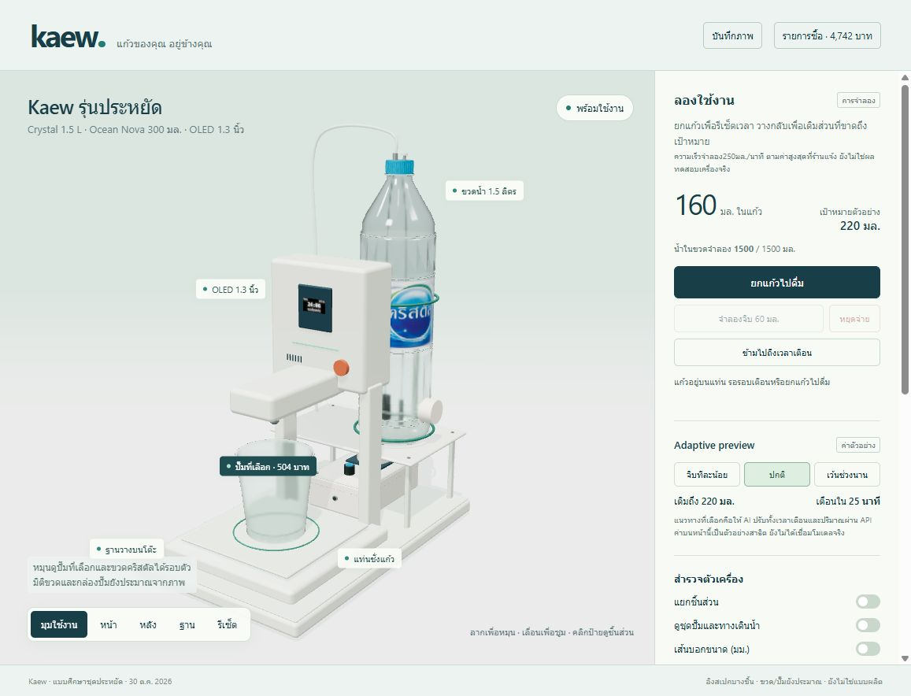

# Kaew — เครื่องเติมน้ำอัจฉริยะ

โมเดล 3D แบบโต้ตอบของ Kaew พร้อมภาพอุปกรณ์ ลิงก์ Shopee และงบประมาณตั้งต้น **4,742 บาท** (ข้อมูล 30 ตุลาคม 2026)

- **[เปิดโมเดล 3D](https://theanrawich.github.io/Kaew/)** — หมุน ซูม แยกชิ้นส่วน ดูภายใน/มิติ และจำลองเติมน้ำ
- **[ดูรูปอุปกรณ์](https://theanrawich.github.io/Kaew/kaew-parts.html)**
- [รายการซื้อและงบประมาณ](KAEW_SHOPPING_LIST.md) · [ข้อมูล BOM](kaew-bom.json)



## ขอบเขตโมเดล

ต่อยอดรูปทรงเดิมโดยอิงปั๊มที่เลือก 504 บาท, จอ OLED 1.3 นิ้ว SH1106 ราคา 139 บาท, ขวด Crystal 1.5 ลิตร และแก้ว Ocean Nova Rock B06511 ขนาด 300 มล. ใช้หน่วยมิลลิเมตรในแบบ และมีโหมดจำลองการยกแก้ว/จิบ/เติมน้ำ รวมถึงบันทึกภาพ PNG

แก้วมีมิติผู้ผลิตปาก 83 / ฐาน 63 / สูง 90 มม. ส่วนขวด Ø85 × 320 มม. และกล่องปั๊ม 80 × 125 × 40 มม. เป็นค่าประมาณสำหรับจัดวาง ยังต้องวัดชิ้นงานจริง ตัวเครื่องเสนอฐาน 220 × 350 มม. สูงรวม 450 มม. ไฟล์นี้ใช้ดูแนวคิดและสัดส่วน ไม่ใช่แบบพร้อมผลิต

งบ 4,742 บาทรวมค่าประมาณโครง ของประกอบ ค่าส่ง และเงินสำรองแล้ว แต่ยังไม่มี flow sensor รุ่นที่ยืนยันได้ โดยกันงบไว้ 300 บาท ราคาสินค้า ตัวเลือก สต็อก การควบคุมปั๊มจาก ESP32 และวัสดุสัมผัสน้ำดื่มยังต้องตรวจสอบก่อนซื้อ ระบบ AI/เสียงและฮาร์ดแวร์จริงยังไม่ได้ทดสอบ อ่านรายละเอียดใน [รายการซื้อ](KAEW_SHOPPING_LIST.md)

## เปิดในเครื่อง

เปิด `kaew-3d.html` หรือ `kaew-parts.html` ได้โดยตรง ทั้งสองไฟล์รวมภาพและโค้ดที่ใช้แสดงผลไว้ในตัว หรือใช้ local server:

```sh
python -m http.server 8765 --bind 127.0.0.1
```

จากนั้นเปิด `http://127.0.0.1:8765/kaew-3d.html` ต้องใช้เบราว์เซอร์ที่รองรับ WebGL

## แก้ไขและสร้างไฟล์

ต้องมี Node.js 22 และ npm

```sh
npm ci --prefix .work/toolchain
node .work/build-kaew.cjs
node .work/make-parts-gallery.cjs
node .work/check-standalone.cjs
node .work/stage-pages.cjs
```

- `.work/kaew-viewer.js` — โมเดลและพฤติกรรม Three.js
- `.work/kaew-template.html` — หน้า HTML/CSS
- `kaew-bom.json` — ราคา รายการซื้อ และแหล่งอ้างอิง
- `references/parts-gallery-20261030.json` — รายการภาพอุปกรณ์
- `output/real-parts/hero.jpg` — ภาพตัวอย่างโมเดล

GitHub Actions สร้างไฟล์และ deploy GitHub Pages อัตโนมัติเมื่อ push เข้า `main` โดยเผยแพร่เฉพาะโมเดล แกลเลอรี BOM และรายการซื้อจาก `_site/` หน้าแรกใช้โมเดล 3D

Repository นี้เก็บเว็บ ซอร์สสร้างเว็บ และภาพอุปกรณ์ที่ใช้จริง เอกสารรายวิชา ไฟล์ข้อเสนอ PDF/Word ภาพลงทะเบียน และไฟล์ทำงานชั่วคราวเก็บอยู่ในเครื่อง

## ที่มาภาพและไลบรารี

ภาพขวดอ้างอิง Lotus’s ภาพแก้วอ้างอิง Ocean Glass และภาพอุปกรณ์จากร้านที่ลิงก์ไว้ในรายการซื้อ ใช้เพื่ออ้างอิงชิ้นส่วนของโครงงาน สิทธิ์ในภาพเป็นของเจ้าของต้นทาง ไม่มีการให้สิทธิ์ใหม่แก่ภาพเหล่านั้น Three.js ใช้สัญญาอนุญาต MIT และฝังข้อความอนุญาตไว้ใน HTML ที่สร้างแล้ว
