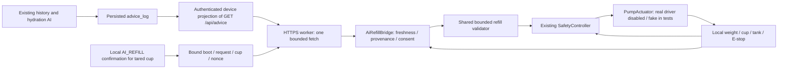

# M4: locally confirmed AI recommendation → gateway safety loop

Author: **Ratchapol Srisongkram (Arm)**, with Codex assistance for development/review; Arm must review and physically validate before claiming hardware results.

17 November 2026. Built on merged PR #8 and `origin/main` baseline `d8d164e`. This implements a software path from the existing cloud model decision to the existing local dispensing controller. **Physical pump commissioning remains 0, GPIO/polarity remain unspecified, and no board was flashed or pump energized.** Actual model quality, TLS/Wi-Fi behavior and hardware cutoff remain physical/integration work, not proven by host tests.

## What closes the software loop



AI changes the requested **total water in the cup**, rather than choosing a fixed gateway preset. The gateway retains authority over start, target caps, timeout, no-flow, excessive rise, cup removal, stale/invalid sensors, E-stop and latched STOP/RESET. A local confirmation permits exactly one response, not an autonomous refill mode. Cup return, connectivity recovery, reboot and fault recovery never create consent.

The model/provider, prompt, reminder scheduling and dashboard API have not been redesigned. `GET` only reads a stored decision; it does not invoke a paid inference or reschedule a reminder. The existing `actuation_allowed:false` remains **false**: the cloud grants no authority to energize an actuator. Authority must come from the separately enabled, one-shot local intent and future verified hardware commissioning. Setting the remote flag to true is rejected, not treated as a bypass. Unvalidated `request(..., RemoteAI, ...)` still returns `RemoteDisabled`; only the bridge can enter the private shared validator after matching local consent.

## Gateway design and local safety

The sensor node sends 20-byte KW v1 CRC16 frames with session/sequence and up to four retries. A separate safety receiver applies validated dry/unknown tank data even when delivery queues are full; duplicates never refresh freshness, and wet tank data expires after 5 seconds. Delivery ACK follows durable NVS persistence, not cloud receipt. Persistence and HTTPS run outside the control loop.

HX711 acquisition runs in a separate core-0 task with an eight-sample queue so a blocking read cannot block control. Queue overflow blocks dispensing until reboot; failed task/queue creation leaves no usable scale input. Calibration uses measured zero/known-weight counts with version/checksum in NVS. Idle cup detection uses a five-sample median, ≤5 g spread and three stable observations; dispensing uses the latest calibrated sample directly so filtering cannot hide cup removal or target crossing. Tare is invalidated by cup loss, invalid/stale inputs, instability in Idle, calibration, fault, reset or reboot.

The state path is Idle → Dispensing → Settling → Idle; faults and explicit STOP latch Faulted. RESET requires safe inputs, never starts dispensing, and requires a fresh empty-cup TARE and new request afterward. Gateway example limits are scale stale 500 ms, no progress 5 s, dispensing 30 s, settling 1 s, progress 3 g, drop 20 g, rise 1000 g/s, cup 30–900 g and total water cap 300 mL. These are unmeasured prototype settings, distinct from controller-class defaults. E-stop, stale/invalid scale, cup, tank and then plausibility/time/progress checks can stop dispensing; the first reported fault does not establish that other inputs are safe.

Manual commands carry version, boot session, increasing ID, gateway timestamp and total-water target; rejected IDs are consumed and cannot start later. See the [command contract](GATEWAY_REFILL_CONTRACT.md). Physical commissioning additionally requires verified independent cutoff, actual pins/polarities and electrical review. GPIO43/44 remain reserved for UART0; compile guards cannot prove wiring or physical power removal. Trace builds forbid pump commissioning. Packet measurements require final zero-drop counters from both boards after the window plus recovery; see the [performance plan](PERFORMANCE_TEST_PLAN.md).

## Authenticated device view of `/api/advice`

Use the existing **device token**, never the admin token, and verified HTTPS:

```text
GET /api/advice?gateway=1&boot_session=<uint32>&request_id=<uint32>&cup_session=<uint32>&nonce=<uint32>
Authorization: Bearer <device-token>
```

All identifiers are nonzero decimal uint32 values; exact query keys, no duplicates or extras. This prototype token is scoped to the existing single registered device setup. Plain device `GET /api/advice` stays unauthorized. Device credentials cannot trigger `POST /api/advice`, read events/history, or write admin settings. The admin dashboard GET/POST contract is unchanged. No production endpoint was deployed during this task; the operator must deploy the reviewed backend before the firmware can use this view.

Response v1 is a flat, bounded projection, without reasons, model secrets or history:

```json
{"version":1,"boot_session":77,"request_id":1,"cup_session":1,"nonce":123,"advice_id":1,"age_ms":100,"suggested_ml":180,"model_backed":true,"actuation_allowed":false}
```

These numbers illustrate the contract only. Server selects the latest non-simulated `advice_log` row, derives age from its stored creation time, and reports model-backed status only when DB and output provenance agree. Missing, future-dated, malformed or ≥120-second-old advice returns 409; invalid queries return 400, failed authentication 401. A fallback remains labeled `model_backed:false` and the gateway rejects it for refill. Simulated-input decisions are never exported in the device view.

The server may recommend 100–400 mL under the existing AI contract. The gateway independently rejects anything over its local maximum (≤300 mL), or a total not exceeding current water, rather than silently increasing/clamping the target. Explicit empty-cup tare is mandatory. Approximation: `gross_target_g = empty_cup_g + suggested_ml`, using 1 g/mL. This does not identify cup capacity or prove delivered volume.

## Admission, expiry and cancellation

1. A local `AI_REFILL` command requires `KAEW_AI_REFILL_ENABLED=1`, Idle, a valid empty-cup tare, stable/fresh calibrated weight, fresh wet tank and safe E-stop status. The default uncommissioned gateway has no verified E-stop status, so this command is blocked on real uncommissioned hardware. Host tests use an explicit fake actuator and synthetic safe inputs to demonstrate the path.
2. The gateway allocates a strictly increasing request ID, current boot ID, volatile tare/cup generation and random nonce. One intent can be pending. ID exhaustion fails closed; no wrapping/reuse.
3. A separate FreeRTOS task performs one HTTPS GET. The main loop only submits/takes bounded queues with zero wait. No automatic request retry, persistent command, general remote command listener or queued offline refill exists. Unknown/oversized bodies, redirects, HTTP failure, missing CA/time, parse failure and late replies fail closed. Only a ≤512-byte exact-schema JSON body is admitted; numeric/boolean types and unique known keys are enforced.
4. Consent expires after **2 seconds from the original local request**, including queue/network delay. A response must echo all four context identifiers. The locally retained timestamp is never replaced with receive time. Authenticated server advice age plus request elapsed time must remain <120 seconds; there is no assumed MCU/server wall-clock alignment for consent expiry.
5. Control ticks cancel pending intent on unsafe inputs, stale scale/tank, cup/tare changes, STOP, RESET, calibration, a manual refill decision, or an active/faulted controller. Console input is processed before AI replies; a serial backlog defers applying a reply, whose original deadline still expires. An old HTTP failure/reply cannot cancel or authorize a newer request. Restoring inputs does not re-arm.
6. A matched reply consumes consent even if invalid, stale, fallback, duplicate or over the local cap. Each admitted decision ID is used at most once per gateway boot, including a rejected disabled/invalid-volume attempt. The shared validator then checks current interlocks and target again immediately before calling `SafetyController::start()` and the actuator interface.
7. On a fault, clear tare, correct the cause, explicitly RESET, establish a new empty-cup tare and make a new local intent. Boot restores no target, tare or consent. A new local intent after reboot can use a still-fresh decision; there is no automatic replay or restart.

## Configuration and hardware gate

| Setting | Default / role |
|---|---|
| `KAEW_AI_REFILL_ENABLED` | **0**; separate opt-in for this locally confirmed AI path |
| `KAEW_ADVICE_URL` | Empty; explicit full trusted HTTPS `/api/advice` URL |
| `KAEW_CLOUD_TOKEN` | Existing private device token; never admin credentials |
| `KAEW_CLOUD_CA`, Wi-Fi settings | Existing private setup; hostname/certificate/time verification required |
| `KAEW_PUMP_COMMISSIONED` | **0**, unchanged; only Suphachok's reviewed wiring/cutoff tests can justify a later commissioning build |
| pump/E-stop pins and polarity | **-1**, unchanged; UART0 GPIO43/44 and existing peripheral/boot/memory reservations remain enforced |
| `KAEW_LOCAL_REFILL_ENABLED` | **0**, unchanged; gates manual volume commands. AI has its own feature gate and still requires physical local confirmation. |

`gateway_ai_compile` compiles AI + publisher code with commissioning still 0; it is **not** a deployment/commissioning authorization. The example local header has commented optional settings only. Advice shares publisher Wi-Fi; if publishing is explicitly disabled, its own worker initializes Wi-Fi using the same private settings. TLS/NTP/network operations stay outside safety control. Network/flash/task scheduling and actual timing need board measurements.

## Repeatable software evidence

```text
python scripts/run_host_tests.py
python -m unittest discover -s cloud/tests -t cloud -p 'test_gateway_advice.py' -v
python -m unittest discover -s cloud/tests -t cloud -p 'test_*.py' -v
python -m unittest discover -s scripts -p 'test_*.py' -v
node --test simulation/*.test.mjs
pio run -d firmware -e sensor_node -e gateway -e gateway_cloud_compile -e sensor_node_trace -e gateway_trace -e gateway_ai_compile
```

The new C++ program has 12 named deterministic scenarios: model-dependent targets/reached stop, disabled feature/no consent, binding/duplicates, once-only decisions/recovery, invalid caps, fallback/staleness/flags, timeout/old network replies, unsafe conditions during fetch, disabled actuator, manual override/STOP, reboot/ID wrap, and strict JSON. Original safety suites and compile-fail pin checks remain intact.

`cloud/tests/test_gateway_advice.py` exercises the actual local HTTP API and compiles `ai_refill_probe.cpp`: a **deterministic test provider** generates 120 and 240 mL recommendations through the existing `recommend/apply_advice` path; the returned device JSON is parsed by the same C++ decoder/bridge/controller and produces fake targets 220 and 340 g for a synthetic 100 g cup, then stops at the target. A 400 mL recommendation is rejected locally. This is inspectable software integration with a mock inference engine and fake actuator; it is **not live model inference, ESP32 execution, measured water or physical safety evidence**.

Recorded M4 results: 9 C++ host programs (25 gateway scenarios and 12 AI scenario groups), 6 GPIO compile checks (2 positive / 4 expected failures), 6 cloud configuration cases; cloud 87 tests (82 passed / 5 optional Postgres skipped); measurement/capture Python 24/24; simulator 25/25; all 6 PlatformIO environments built successfully. Earlier PR #8 recorded 8 C++ programs, cloud 79 tests (74 passed / 5 skipped), simulator 25/25, measurement/capture 24/24 after review, and all 5 then-existing firmware environments built. These historical counts are separate snapshots, not additional current runs. See the [M4 validation summary](validation/m4-ai-loop.md) and [PR #8 summary](validation/software-2026-11-17.md). No cloud deployment, live token/API call, real serial session, board flash or pump operation occurred.

## Handoff and remaining work

- **Theanrawich:** review/deploy the minimal device view; generate a fresh non-simulated model decision using the existing admin dashboard/`POST /api/advice` before a supervised demonstration; confirm TOTAL-volume semantics and review token provisioning. AI/refill status currently appears in local serial diagnostics, not persisted cloud dispense events. Ordinary voice refill remains blocked; no voice stop capability is claimed.
- **Suphachok:** provide verified driver/pump ratings, polarity, independent physical cutoff and fail-safe E-stop status, real level wiring, calibration, cup capacity and overshoot. Keep commissioning off until those checks and supervised tests are complete.
- **Arm:** measure real network/task/shutdown latency, verify faults during fetch/dispensing with hardware, validate limits and report the full physical closed loop. Cold-start or >2-second network latency intentionally rejects the intent; retry only with a new explicit local confirmation after the service is ready. Stored decisions older than 2 minutes need regeneration through the existing AI workflow. Weight alone cannot identify a swapped cup of similar mass, and local console access is a trusted engineering interface.
