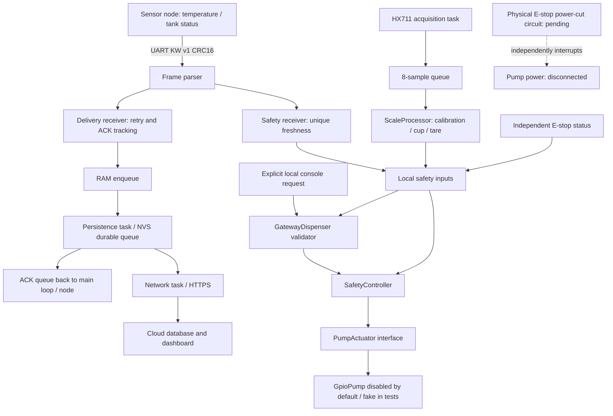
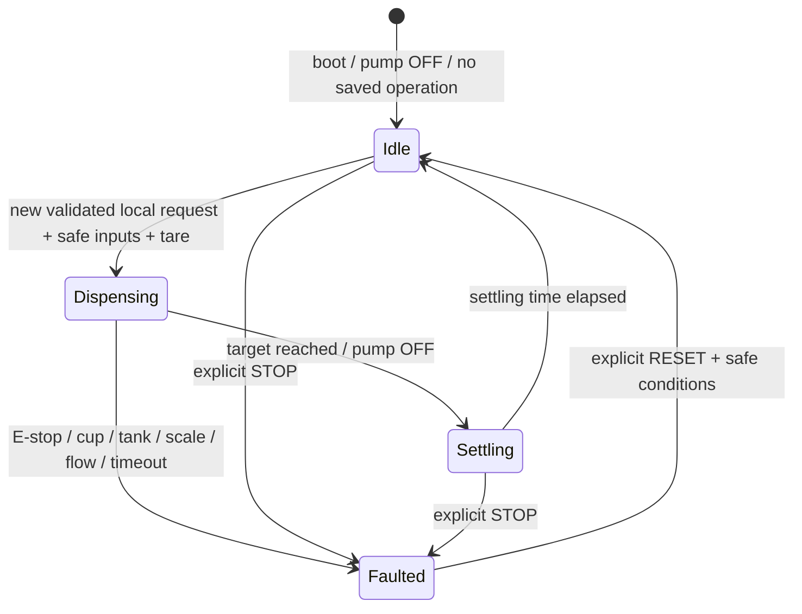

# งาน Gateway และการทดสอบของ Ratchapol (Arm)

งานต่อ M4 จาก PR #8 ดู [AI gateway loop](M4_GATEWAY_AI_LOOP.md) และ [ผลตรวจรอบ M4](validation/m4-ai-loop.md) รายละเอียด/ผลตัวเลขในหัวข้อเดิมด้านล่างเป็นหลักฐานของ PR #8; โค้ดปัจจุบันเพิ่ม locally confirmed AI path โดยไม่เปิด commissioning

ปรับปรุง 17 พฤศจิกายน 2026 · ใช้เตรียมรายงาน/สไลด์และตอบ Q&A · อ้างอิงซอฟต์แวร์ใน branch `feature/ratchapol-gateway-testing` จาก baseline `65a2f0f` สถานะผลตรวจและลายนิ้วมือไฟล์ดู [validation record](validation/software-2026-11-17.md)

**สิ่งที่ยืนยันได้:** เชื่อมเส้นทางคำสั่งกับ SafetyController, ประมวลผล HX711, ทดสอบด้วย fake actuator, เพิ่มเครื่องมือวัดและเอกสาร ส่ง build ผ่านในเครื่องแล้ว **ปั๊มจริงยังปิด, ไม่ได้ flash บอร์ด, ไม่ได้สอบเทียบหรือวัดฮาร์ดแวร์** โค้ดและเอกสารรอบนี้ใช้ Codex ช่วยพัฒนา/ตรวจ Arm ต้อง review ทดลองจริงและอธิบายได้ก่อนนำไปอ้างเป็นผลงานตนเอง ไม่ถือว่าการช่วยเขียนนี้เป็นหลักฐานว่า Arm ได้ลงมือทดสอบวงจรจริงแล้ว

## 1. สถาปัตยกรรม Gateway

`gateway.cpp` จัดการ I/O และเรียก control tick หลายจุดใน loop ส่วน `ScaleProcessor`, `GatewayDispenser` และ `SafetyController` เป็น C++ ที่ทดสอบบน host ได้ `GpioPump` เป็นส่วนเดียวที่เขียน GPIO ปั๊ม การทดสอบใช้ `FakePump` ซึ่งเก็บคำสั่งเปิด/ปิดแทนไฟฟ้าจริง

HX711 0.7.5 ที่ติดตั้งมี `read()` เรียก `wait_ready()` ภายใน แม้ caller ตรวจ ready แล้วก็ยังมีช่วงที่ถอดสายพอดีและค้างได้ จึงแยกอ่านใน task core 0, priority 1 ส่ง raw+timestamp ผ่าน queue ยาว 8 ไป control loop แบบไม่รอ ถ้า task ค้างไม่มีข้อมูลใหม่ loop จะหยุดด้วย stale timeout ถ้า queue overflow จะปิดกั้นการจ่ายจน reboot และตรวจสาเหตุ ไม่มีการถือค่าล่าสุดว่าใหม่เพียงเพราะอ่านซ้ำ การสร้าง task/queue ล้มเหลวทำให้ไม่มีข้อมูลที่ใช้เริ่มจ่าย

Persistence/HTTPS ยังคงอยู่ใน task เดิม ไม่เพิ่มการรอ network ใน safety loop ทั้งนี้ flash writes, scheduler, serial diagnostics และ contention อาจกระทบเวลา จึงยังไม่อ้าง hard real-time หรือ worst-case shutdown bound จาก host tests

## 2. SafetyController และสถานะ

`STOP` ขณะ Dispensing ก็เข้า Faulted เช่นกัน ทุก fault ค้างอยู่ ไม่คืนการจ่ายเมื่อแก้วกลับมา น้ำกลับมา หรือ Internet กลับมา `RESET` ตรวจเงื่อนไขในเครื่องและไม่เปิดปั๊ม หลัง reset แอป clear tare ต้องตรวจแก้วเปล่า `TARE` ใหม่ และส่ง `REFILL` หมายเลขใหม่ Boot สร้าง session ใหม่และไม่โหลดคำสั่ง/target เดิม

ก่อนเริ่มต้องมีแก้วที่นิ่ง สเกลสอบเทียบและข้อมูลสด ถังยืนยัน wet และ E-stop อยู่ในสถานะปลอดภัย ตรวจว่า target เป็นจำนวนจำกัด อยู่ในเพดาน และสูงกว่าน้ำปัจจุบัน ระหว่างจ่ายตรวจทุก sample/loop: scale invalid/stale, tank dry/unknown/stale, cup หาย, น้ำหนักลดผิดปกติ, เพิ่มเร็วเกิน, ไม่คืบหน้า และเวลาสูงสุด ต้องปิดและ latch fault ส่วนถึง target ปิดตามปกติและรอ Settling

ค่าทดลองในแอป: scale stale **500 ms**, no-progress **5 s**, maximum dispensing **30 s**, settling **1 s**; ตั้งค่าเวลา 3 ค่าแรกผ่าน build macros ได้ Controller class เดิมยังมี default 2 s / 30 s / 180 s สำหรับ tests/ผู้ใช้เดิม อย่าสับสนกับ config ของ gateway ค่าอื่นที่ยังเป็นตัวอย่าง ได้แก่ progress 3 g, drop 20 g, rise 1000 g/s, margin 0 g, cup 30–900 g และ total water cap 300 mL **ทุกค่านี้ยังไม่ได้วัดจากอุปกรณ์จริง** ต้องทบทวนก่อน commissioning; 30 s อาจตัดปั๊มช้าที่ใช้งานจริงได้

Fault ตรวจ E-stop ก่อน แล้ว scale freshness/validity, cup, tank จากนั้น plausibility/time/progress สาเหตุที่มีพร้อมกันอาจแสดงเพียงเหตุแรก ไม่ได้หมายความว่าเหตุอื่นปลอดภัย

## 3. คำสั่งและการควบคุมปั๊ม

เส้นทาง `REFILL → GatewayDispenser → SafetyController::start() → PumpActuator::set()` ถูกเชื่อมแล้ว แต่ default ทั้ง actuator commissioning และ local refill enable เป็น 0 ขา pump/E-stop เป็น -1 และ polarity ยังไม่กำหนด ไม่มีขา GPIO15/16 ถูกนำจากตารางเสนอมาเปิดเอง

การเปิด GPIO ในอนาคตต้องมี build ที่ตรวจทาน: `KAEW_PUMP_COMMISSIONED`, `KAEW_INDEPENDENT_CUTOFF_VERIFIED`, ขาที่ใช้จริง, ระดับ ON และ safe E-stop ที่ยืนยันแล้ว รวม `KAEW_LOCAL_REFILL_ENABLED` แยกต่างหาก Compile guards ตรวจ capability/conflict บางส่วน แต่แทนการตรวจวงจร พิกัด ป้องกัน boot pulse/pull resistor และไฟย้อนกลับไม่ได้ `set(false)` เป็นเพียงคำสั่ง ไม่ใช่ feedback ว่ากำลังถูกตัดหรือมีน้ำหยุดจริง

คำสั่งมี version, gateway boot session, ID เพิ่มขึ้น, timestamp ใน clock gateway และ target **ปริมาณน้ำทั้งหมดในแก้ว** ID ซ้ำ/เก่าและคำสั่งหมดอายุไม่เริ่มงานใหม่ คำสั่งที่ถูกปฏิเสธเพราะ busy/unsafe/volume/expired ใช้ ID นั้นแล้ว จึงไม่รอเปิดเองภายหลัง RemoteAI ถูกปฏิเสธเสมอ ดู [สัญญาและผลตอบกลับครบถ้วน](GATEWAY_REFILL_CONTRACT.md)

## 4. HX711 การตรวจแก้วและ tare

Calibration: `counts_per_g=(loaded_raw-zero_raw)/known_g` จากค่าชั่งจริง รองรับค่าลบตามการต่อ load cell เก็บ version/checksum ใน NVS; หากไม่ถูกต้องไม่ยอมใช้ข้อมูล ต้องตรวจหลายน้ำหนักอิสระหลัง CAL ไม่ใช้ factor สังเคราะห์ใน host test กับเครื่องจริง

ตอน Idle ใช้ median 5 ค่าและช่วงแกว่งไม่เกิน 5 g พร้อม cup observations ที่นิ่ง 3 ครั้งก่อนยอมว่ามีแก้ว ระหว่าง Dispensing/Settling ใช้ **sample calibrated ล่าสุดโดยตรง** เพื่อให้ median ไม่ซ่อนการยกแก้ว น้ำหนักพุ่ง หรือผ่าน target ยกออกจนต่ำกว่าเกณฑ์จะหยุดใน processing tick ของ sample นั้น; ถ้าน้ำหนักยังเกิน cup threshold แต่ตกจากจุดสูงสุดเกิน 20 g จะ fault เช่นกัน นี่เป็นพฤติกรรมซอฟต์แวร์ ไม่ใช่หลักฐานเวลา/ความไวของเครื่องจริง

ชั่งครั้งเดียวไม่รู้ว่าเป็นแก้วชนิดใด มีความจุเท่าไร หรือมีน้ำอยู่แล้วเท่าไร ต้องให้ผู้ใช้ยืนยันแก้วเปล่าก่อน `TARE` การแปลงกรัมเป็น mL ใช้ 1 g/mL โดยประมาณ Target gross = empty-cup tare + total-water target ไม่รวม tare เป็นปริมาตรน้ำ และไม่ถือว่าเติมเท่ากับดื่ม

Tare หายเมื่อแก้วหาย/ข้อมูลไม่ถูกต้อง/ไม่นิ่งใน idle/stale/recalibration/fault/reset/reboot ต้องสร้างใหม่อย่างชัดเจน ค่าที่ค้างแต่ยังออก conversion เป็นค่าคงที่แยกจากน้ำไม่ไหลไม่ได้ จึงมี no-progress timeout และเวลารวม แต่ยังไม่มี flow sensor อิสระ ไม่มี redundant flow protection

## 5. UART และ cloud ที่เกี่ยวข้อง

คง protocol 20-byte KW v1, CRC16, session/sequence, ACK และ retry 4 ครั้งไว้ ไม่เพิ่ม pump command ใน UART Node อุณหภูมิทำงานตามโค้ดเดิม; level/TDS ยังปิดและส่ง unknown จึงไม่สามารถจ่ายจริงจากค่าถังที่ไม่ยืนยันได้

Safety receiver แยกจาก delivery receiver: dry/unknown packet ที่ผ่าน validation ถูกใช้หยุดทันที แม้ cloud RAM/NVS queue เต็มจนไม่ ACK ส่วน delivery state rollback ตามเดิมเพื่อให้ retry/persist ได้ Duplicate ไม่ refresh tank age; wet data หมดอายุ 5 s จึงใช้ต่อไม่ได้ ต่อให้ Internet ยังทำงาน

เมื่อ cloud เปิด ACK ยังมาจากการเขียน NVS สำเร็จผ่าน ACK queue; HTTPS bearer, CA/time verification, durable queue และ retry task เดิมไม่ได้ถูกแทนที่ ไม่อ้างว่า ACK คือ cloud delivery ไม่เปลี่ยน AI, dashboard, NVS format หรือ API ของ Theanrawich

เพิ่ม `packet_trace.h` และ build trace แบบ opt-in เพื่อเก็บ tx/rx/ack/drop พร้อม packet key; `node.cpp` เปลี่ยนเฉพาะ hook วัดผล/diagnostic ไม่เปลี่ยนการตัดสินใจ AI หรือเซนเซอร์เพื่อน เมื่อ trace ไม่มีที่ส่งจะ drop log และแจ้ง counter เพื่อให้ถือว่าการวัดครั้งนั้นใช้ไม่ได้ ค่า trace ปิดใน default builds และ build trace ห้ามเปิด pump commissioning ร่วมกัน

## 6. วิธีทดสอบและผลยืนยัน

ใช้เวลา/ข้อมูลกำหนดแน่นอนใน C++ host tests และ fake actuator รันซ้ำได้ ไม่เชื่อมบอร์ดหรือส่งคำสั่งจริง New suite ใช้ modules เดียวกับ firmware สำหรับ scale, request validator และ SafetyController ส่วน GPIO/FreeRTOS/ไฟฟ้าไม่ได้จำลองครบ จึงต้องมี physical integration tests แยก JavaScript plant ยังคงเป็นอีก implementation ไม่ถือว่ามี formal equivalence กับ C++

| รายการตามโจทย์ | Automated scenario ใน gateway suite | ผล host |
|---|---|---|
| 1 ปกติ | `valid_refill` | PASS |
| 2 ไม่มีแก้ว | `no_cup` | PASS |
| 3 ยกแก้วระหว่างจ่าย | `cup_removed_first_sample`, `partial_lift` | PASS |
| 4 E-stop | `estop` | PASS |
| 5 ถังต่ำ/unknown | `tank_low_unknown` | PASS |
| 6 HX711 invalid/disconnected representation | `invalid_hx711`, `stale_scale` | PASS |
| 7 stale reading | `stale_scale`, `stale_idle_and_clock_wrap` | PASS |
| 8 น้ำหนักไม่เพิ่ม | `no_progress` | PASS |
| 9 เพิ่มเร็วผิดปกติ | `excessive_rise` | PASS |
| 10 timeout | `timeout` | PASS |
| 11 คำสั่งซ้ำ/ซ้อน | `duplicates_overlap`, rejected replay | PASS |
| 12 target ผิด | `invalid_target` | PASS |
| 13 boot ปิด | `reboot_off` | PASS |
| 14 recover | `explicit_recovery` | PASS |
| 15 network/AI ข้าม safety ไม่ได้ | `remote_network_failure`, backpressure | PASS |
| 16 target reached | `target_reached` | PASS |
| 17 หยุดอัปเดต | `stale_scale`, `tank_stops_updating` | PASS |
| 18 start/stop ซ้ำ | `repeated_operations` 20 รอบ | PASS |

รวม C++ **8 programs**, ใน suite ใหม่ **25 scenarios**; configuration matrix **6 cases**; เพิ่ม GPIO compile checks **6 cases** (positive controls 2 และ expected compile failures 4); measurement/capture Python **24 tests** ผ่านหลังแก้ review ส่วน simulator **25 tests** และ cloud Python **79 tests: 74 ผ่าน, 5 ข้ามเพราะไม่ได้ตั้ง optional Postgres test DB** เป็นผลจาก implementation เดิมที่ source ไม่เปลี่ยน Build ทั้ง 5 environments ผ่านในรอบแรก และ build gateway 3 environments ผ่านอีกครั้งหลังแก้ pin guard หลักฐานและ command อยู่ใน [validation](validation/software-2026-11-17.md) งานเดิม push เป็น commit `e2b60d3` แล้วใน [PR #8](https://github.com/theanrawich/Kaew/pull/8) และ [CI ของ commit นั้นผ่าน](https://github.com/theanrawich/Kaew/actions/runs/44014634559) ผล CI ของ review-fix ให้ดูที่ PR

หลัง review กัน GPIO43/44 ไว้เสมอ เพราะ console `Serial` อาจใช้ UART0 TX43/RX44 ทดสอบ compile-fail โดย include header จริงและเปิด commissioning เฉพาะใน host fixture ที่มี inert GPIO stubs ไม่ได้สร้าง/flash firmware เปิดปั๊มจริง ส่วน PDR ต้องมี `trace_dropped=0` ปิดท้ายจากทั้งสองบอร์ดหลังจบ window + recovery จึงยอมสร้างผล ช่วงรอ counter ไม่ถูกนับเป็นเวลาวัดเพิ่ม

## 7. การวัดและงานที่ต้องใช้เครื่องจริง

เตรียมแผน ≥3 metrics: event-to-actuator latency (รวม shutdown), unique packet delivery rate และ HX711 accuracy พร้อม optional volume/overshoot วิธีจับเวลา/clock, test points 0/50/100/200 g, repetitions, สูตร error/mean/min/max/SD, CSV ว่าง, analyzer และ capture tool อยู่ใน [performance plan](PERFORMANCE_TEST_PLAN.md) ข้อมูลใน unit tests เป็น synthetic เพื่อเช็กสูตรเท่านั้น ผลทดลองจริงทุกรายการยัง BLOCKED

ต้องมีวงจร independent E-stop ตัดกำลังจริงและทดสอบ MCU ค้าง/ไฟกลับ/สายขาด, driver/pump/adapter พิกัดตรงกัน, สอบเทียบและวัด rate/noise HX711, ยืนยัน level input, ทดสอบ cup removal หลายจังหวะ, timeout/no-flow/overshoot, น้ำไหลต่อ/siphon, TLS/NTP/Wi-Fi/NVS power-cut และ load ขณะเสียง/เครือข่ายทำงาน ระวัง flash scheduling stalls และ serial diagnostic delay ไม่มี software test ใดรับรองความปลอดภัยไฟฟ้าหรือน้ำดื่ม

## 8. ขอบเขตและงานต่อ

เพิ่ม opt-in local-confirmed AI pull adapter แล้วตาม [M4 design](M4_GATEWAY_AI_LOOP.md) ส่วน general remote pump commands, cup identity/capacity sensor, driver feedback, hardware-calibrated thresholds และ worst-case stop latency ยังไม่พร้อม `CAL/TARE/REFILL` ผ่าน local console เป็น engineering interface ไม่ใช่ UX ผู้ใช้สุดท้าย Fault/dispense events ยังไม่ถูกส่งขึ้น cloud ด้วย publisher เดิม

Suphachok/ทีม hardware ส่งวงจรและค่าตรวจจริงตาม [handoff](GATEWAY_REFILL_CONTRACT.md); Theanrawich ตกลง total/add semantics, authentication/expiry/cup confirmation และ event reporting ก่อนทำ adapter Arm ทำ physical measurements, ปรับ limits จากผลจริง, review โค้ด, commit ด้วย identity จริงของตน และเก็บหลักฐาน ห้ามใช้ commit ที่ยังไม่เกิดหรืออ้าง AI/helper เป็นผลทดลอง

ก่อน **20 พ.ย.**: P0 ยืนยันบอร์ด/สายจริงและทำ temperature node→gateway→HTTPS→dashboard video โดยปั๊มถอดไฟ, เก็บ build/serial/session/evidence, ทวนกำหนดส่งจากรายวิชา, ตั้ง Git identity/commit งานที่ review แล้ว P1 เริ่ม calibration และ UART PDR เมื่ออุปกรณ์พร้อม

ก่อน **8 ธ.ค.**: P0 ทำ commissioning แยกพร้อมคนตรวจและอนุญาต, กำหนด/วัด stop/overshoot/capacity, fault injection และ recovery ทุกกรณี P1 เก็บ ≥3 metrics ซ้ำพร้อม raw/analysis และ integration กับ AI ตามขอบเขต P2 ทดลองต่อเนื่อง/ผู้ใช้ตามข้อกำหนด ทำสไลด์/รายงาน/วิดีโอจริงและซ้อม Q&A วันที่นี้อิงแผนใน repo/คำขอ ต้องตรวจประกาศวิชาล่าสุดเอง

## 9. อธิบายโค้ดแบบใช้ตอบอาจารย์

“แก้วใช้ AI ช่วยเสนอ แต่ gateway เป็นคนตัดสินว่าจะเริ่มได้หรือไม่ เริ่มจากสอบเทียบเครื่องชั่ง รอแก้วนิ่ง และ tare แก้วเปล่า เมื่อได้คำสั่งใหม่ gateway ตรวจปริมาณ อายุคำสั่ง ข้อมูลถัง สเกล และปุ่มหยุด แล้วแปลงเป้าหมายน้ำเป็นน้ำหนักรวม SafetyController อนุญาตให้เปิดเฉพาะช่วง Dispensing ทุก loop ตรวจความผิดปกติ ถึงน้ำหนักเป้าหมายก็ปิดและรอให้นิ่ง ถ้าแก้วถูกยก น้ำต่ำ สเกลขาด ไม่มีน้ำไหล หรือเกินเวลา จะปิดและค้าง fault ต้องแก้ ตรวจ safe และ reset/สั่งใหม่เอง หลัง reboot ไม่เติมต่อ ในรอบนี้พิสูจน์ logic ด้วย fake pump เท่านั้น ปั๊มจริงยังปิดและ E-stop ต้องตัดไฟได้โดยไม่พึ่ง MCU”

## 10. รายการไฟล์ที่เปลี่ยน

พาธด้านล่างเริ่มจาก repository root รายการ hash รายไฟล์อยู่ใน validation manifest

| ไฟล์ | การเปลี่ยนแปลง |
|---|---|
| `firmware/src/gateway.cpp` | เชื่อมคำสั่ง, scale acquisition task, control ticks และ tank safety receiver |
| `firmware/include/safety.h`, `scale_processing.h` | ตรวจ limits, stop/reset และ scale/cup/tare processing |
| `firmware/include/dispensing.h` | request validator, target calculation และ actuator abstraction ใหม่ |
| `firmware/include/gateway_commands.h` | parser และ bounded console framing ใหม่ |
| `firmware/include/pump_gpio.h` | GPIO adapter พร้อม default ปิดและ commissioning guards ใหม่ |
| `firmware/include/packet_trace.h`, `firmware/src/node.cpp` | optional packet instrumentation/diagnostic สำหรับงานวัดผล |
| `firmware/platformio.ini` | เพิ่ม trace environments โดย default targets ยังเป็น node/gateway |
| `firmware/test/gateway_dispensing_test.cpp` | 25 deterministic scenarios ด้วย fake hardware |
| `scripts/run_host_tests.py`, `firmware/test/pump_gpio_compile_test.cpp` | รัน suites, cloud config matrix และ pin compile-fail checks โดยไม่เรียก hardware |
| `scripts/analyze_measurements.py`, `capture_packet_delivery.py` | วิเคราะห์ CSV และเตรียมจับ serial packet logs |
| `scripts/test_analyze_measurements.py`, `test_capture_packet_delivery.py` | 24 tests ของสูตร/validation/recorder ด้วย synthetic fixtures |
| `.github/workflows/firmware.yml` | เพิ่ม suites และ compile trace environments ใน CI |
| `docs/GATEWAY_REFILL_CONTRACT.md` | สัญญาคำสั่งและสิ่งที่ต้องส่งมอบจากทีม |
| `docs/PERFORMANCE_TEST_PLAN.md` | ขั้นตอนวัด 3 metrics และ optional volume/stop |
| `docs/measurements/latency.csv`, `packets.csv`, `accuracy.csv`, `volume.csv`, `test-runs.csv` | templates ว่าง ไม่มี measurements สมมติ |
| `docs/RATCHAPOL_GATEWAY_REPORT.md` | รายงานผลงาน/architecture/state/Q&A ฉบับนี้ |
| `docs/validation/software-2026-11-17.md`, `.txt`, `.json` | ผลรันจริง, output และ source hashes |
| `README.md`, `firmware/README.md` | สถานะปัจจุบันและวิธีใช้/ทดสอบ |
| `docs/wiring.md`, `CHECKPOINT_CRITICAL_PATH.md`, `TEST_RECORD_TEMPLATE.md`, `course-evidence.md`, `EXECUTION.md` | ลิงก์และสถานะหลักฐานเพิ่มเติมโดยรักษา hardware HOLD |
