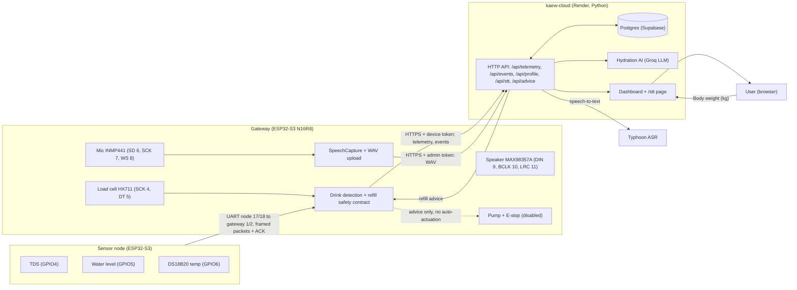

# Kaew architecture

## Data flow

1. The sensor node reads TDS, water level and temperature and sends framed packets to the gateway over UART; the gateway acknowledges each packet.
2. The gateway publishes node telemetry and detects drinks independently using calibrated HX711 readings. It confirms that the platform unloads and the returned cup settles, then converts a 10–1000 g decrease into an estimated volume at 1 g/mL. Weight increases are ignored. Drinks and telemetry share the durable retry queue.
3. The device token can post measured drinks to `/api/events` using the single gateway's ID namespace. Event history remains admin-only. The cloud stores data in SQLite or Postgres and serves the dashboard.
4. The user enters body weight through the dashboard via admin-authenticated `GET/POST /api/profile`. The cloud derives the daily goal at 33 mL/kg, bounded to 1,000–4,000 mL.
5. The server initializes a missing reminder schedule at startup and checks for a missing row in the reminder loop. Saving weight, recording a new drink and firing a repeating reminder each trigger an AI decision. Groq receives the weight, goal and recent history. If the model is unavailable, the server schedules a deterministic 60-minute interval. The dashboard displays the schedule.
6. The gateway sends microphone audio to `/api/stt?command=1` for Typhoon ASR and intent parsing. Voice can report device connection status. Voice refill stays blocked and pump commissioning stays disabled.

## Wiring

| Board | Part | Pins |
| --- | --- | --- |
| Sensor node | TDS (analog, <= 3.3 V output) | GPIO4 |
| Sensor node | Water level (digital) | GPIO5 |
| Sensor node | DS18B20 (4.7 kΩ pull-up on DQ) | GPIO6 |
| Sensor node | UART to gateway | TX 17, RX 18 |
| Gateway | HX711 load cell | SCK 4, DT 5 |
| Gateway | INMP441 microphone (L/R to GND) | SD 6, SCK 7, WS 8 |
| Gateway | MAX98357A speaker | DIN 9, BCLK 10, LRC 11 |
| Gateway | UART to node | RX 1, TX 2 |
| Gateway | Pump / E-stop | not assigned (disabled) |

Cross UART TX/RX between boards and share GND.
