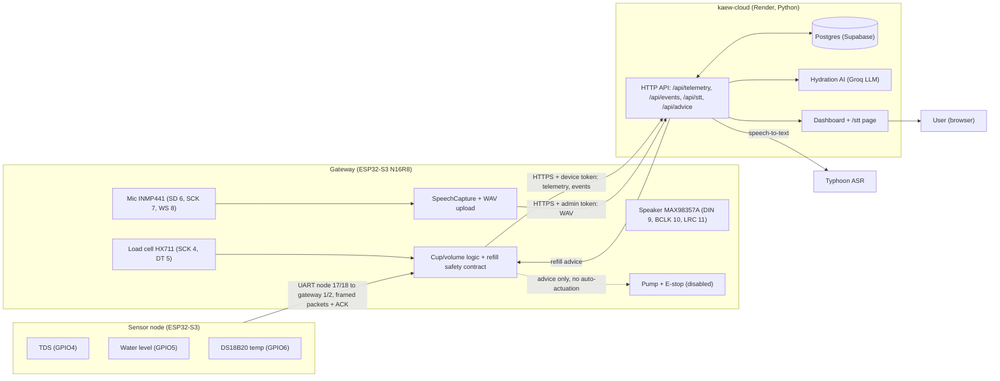

# Kaew architecture

## Data flow

1. The sensor node reads TDS, water level and temperature and sends framed packets to the gateway over UART; the gateway acknowledges each packet.
2. The gateway combines node data with the load-cell cup/volume reading and publishes telemetry and events to the cloud over HTTPS.
3. The cloud stores data in Postgres and serves the dashboard.
4. Voice: the gateway segments speech from the microphone, uploads WAV to `/api/stt?command=1`, the cloud transcribes it with Typhoon ASR and returns a parsed command.
5. Hydration advice comes from the Groq LLM. The pump stays disabled; voice and advice never actuate it directly.

## Wiring

| Board | Part | Pins |
| --- | --- | --- |
| Sensor node | TDS (analog, <= 3.3 V output) | GPIO4 |
| Sensor node | Water level (digital) | GPIO5 |
| Sensor node | DS18B20 (4.7 kΩ pull-up on DQ) | GPIO6 |
| Sensor node | UART to gateway | TX 17, RX 18 |
| Gateway | HX711 load cell | SCK 4, DT 5 |
| Gateway | INMP441 microphone (L/R to GND) | SD 6, SCK 7, WS 8 |
| Gateway | MAX98357A speaker | DIN 9, BCLK 10, LRC 11 |
| Gateway | UART to node | RX 1, TX 2 |
| Gateway | Pump / E-stop | not assigned (disabled) |

Cross UART TX/RX between boards and share GND.
